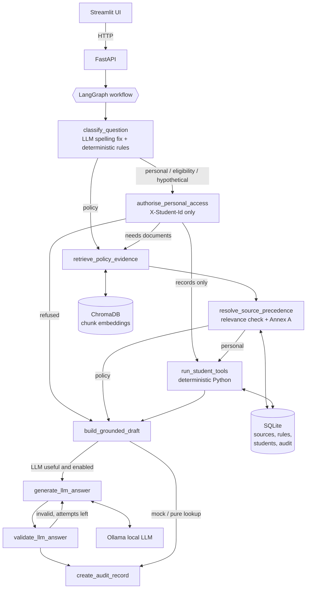

# AI-Powered University Student Services Assistant

HCLTech Future Ready AI Engineer Hackathon. A question-answering service that answers university
policy questions from authorised documents and personal questions from authorised synthetic student
records. Every answer comes with citations, the tools that ran, the rules that were applied, any
source conflicts, and a trace ID that links to an audit record.

> **Corpus.** Three official, public documents of Dr B R Ambedkar NIT Jalandhar (`data/documents/official/`,
> registered in `source_register.csv`, no synthetic documents):
>
> | doc_id | Document | Annex A level | Effective | Scope | Notes |
> |---|---|---|---|---|---|
> | NITJ-6M-INTERNSHIP-POLICY-REV | Institute's 6-Months Internship Policy (Revised) | 2 | 2021-09-10 | ALL | Native text, 3 pages. States two different backlog limits (Key Point 1 vs Guidelines to the Students 2) |
> | NITJ-PLACEMENT-POLICY-2026-27 | Placement & Internship Policy (2023-2027 Batch Onwards) 2026-27 | 2 | 2026-06-01 | batches 2023+ | **Scanned**, 15 pages, OCR. Changes the 6-month internship rules (7th or 8th semester) |
> | NITJ-PLACEMENT-BROCHURE-2023-24 | Placement Brochure 2023-24 | 4 | 2023-09-15 | ALL | Charts and tables as images, OCR on image pages |
>
> The two policies give real versioning: for 2023+ batches the 2026-27 policy prevails by recency (Annex A
> step 4); before 2026-06-01, or for batches before 2023, the 2021 policy applies and its two backlog
> statements are an unresolved conflict (step 5). Effective dates that are not printed in a document are taken
> from the PDF metadata or the clause they come from, as recorded in the register's `provenance` column.
> A frozen synthetic corpus used only by the automated tests lives in `tests/fixtures/`.

---

## 1. Problem statement and scope
Students ask about attendance, exams, fees, placements, scholarships, hostels and their own records.
The assistant must:
- answer only from authorised sources, with exact citations, and abstain otherwise;
- compute personal results (attendance, eligibility) with deterministic code, never with the LLM;
- resolve conflicting document versions using the prescribed precedence policy (Annex A);
- refuse access to other students' data;
- accept new documents at runtime and search them immediately.

Supported answer types: `retrieved_fact`, `calculated`, `not_found`, `clarification_needed`,
`refused`, `conflict_flagged`.

## 2. Architecture



The same flow in text: `START -> classify -> [authorise] -> [retrieve -> precedence] -> [tools] -> draft -> [LLM <-> validate] -> audit -> END`.
Steps in brackets run only when they are needed.

## 3. Component responsibilities

| Folder | Responsibility |
|---|---|
| `app/api/` | HTTP routes only: `/ask`, `/ingest`, `/health`, `/audit/{id}`, `/sources` |
| `app/graph/` | `classifier.py` (deterministic question analysis), `nodes.py` (one function per step), `workflow.py` (graph wiring), `state.py` (typed state) |
| `app/ingestion/` | `parser.py` (PDF/TXT/MD → text per page), `chunker.py` (section-aware chunks), `pipeline.py` (all-or-nothing indexing) |
| `app/retrieval/` | embeddings, ChromaDB wrapper, semantic search plus keyword-coverage evidence check |
| `app/services/` | `precedence.py` (Annex A), `rule_registry.py` (applicable rules), `source_registry.py` (CSV register), `answer_builder.py` (deterministic answers, citations, explanation), `audit_service.py` |
| `app/tools/` | student record tools, eligibility checks, attendance arithmetic |
| `app/llm/` | Ollama client, prompts, output validation |
| `app/database/` | schema (Annex C + sources + audit), connection, all SQL (`repositories.py`), CSV validation |
| `scripts/` | ingestion, rule registry build, student generation/validation/loading, evaluation, data card |
| `ui/` | Streamlit demo; it only calls the API |

## 4. Request lifecycle (one end-to-end example)
`POST /ask` with header `X-Student-Id: S1003`, body `{"question": "Am I elligible for the 6-month internship?"}`:
1. Pydantic validates the body; a `trace_id` is created; `as_of_date` defaults to today.
2. **classify_question** first asks the LLM to correct spelling and grammar (the correction is rejected if it changes any student ID, course code or number), then finds a personal signal ("Am I") and eligibility wording, so the category is `eligibility`. It matches the check `internship` against the checks registered in the rule registry.
3. **authorise_personal_access** checks the header format, that the question names no other student ID, and that S1003 exists. No document text or LLM output is involved.
4. No procedure wording, so retrieval is skipped.
5. **run_student_tools** → `get_applicable_rules("internship")` finds backlog and semester rules in both policies. Both are level 2, so Annex A step 4 (recency) selects the 2026-27 policy (`INT6M-BKLG-2026: active_backlogs <= 3`, `INT6M-SEM-2026: current_semester in 7,8`) and records the resolved conflicts. `check_eligibility` reads S1003's record: 4 backlogs (not met), semester 7 (met), giving **not eligible**.
6. **build_grounded_draft** writes the answer from the tool output and cites `NITJ-PLACEMENT-POLICY-2026-27, page 7, version 2026-27, effective 2026-06-01`, built from stored metadata.
7. Pure tool answers skip the LLM. **create_audit_record** stores the decisions, tool names and inputs, rule IDs and latency under the trace ID.

## 5. Why LangGraph
The workflow has real branches: refuse early, skip retrieval, skip tools, retry the LLM a bounded number of times. LangGraph makes each step a named node and each branch an explicit conditional edge, so the flow can be drawn, tested and explained. We use one fixed workflow, not multiple agents. Routing decisions are deterministic Python functions (`route_after_*`), so the same question always takes the same path.

## 6. Why all-MiniLM-L6-v2
It is small (~90 MB) and runs on CPU in milliseconds per query. It produces 384-dimension embeddings that work well for short English policy clauses, and it is the mandated default. It runs locally, so no document text leaves the machine. Because similarity scores are not proof, a keyword-coverage check is applied on top (section 7).

## 7. ChromaDB vs SQLite
- **ChromaDB (vector database)** answers "which passages *mean* something similar to this question?" It stores chunk embeddings plus metadata and persists in `data/chroma`.
- **SQLite (relational database)** answers exact questions: "what is S1002's attendance in CS201?", "which rules apply on this date?", "what is the authority level of this document?" It holds the source register, rule registry, student tables and audit log, with foreign keys and parameterized queries.

Retrieval gives *candidates*; SQLite metadata and rules decide what is *authoritative*.

**Retrieval vs evidence.** A chunk counts as evidence only if its cosine distance is ≤ `RETRIEVAL_MAX_DISTANCE` (0.5) **and** at least `MIN_KEYWORD_COVERAGE` (50%) of the question's content words appear in it. In the evaluation, removing the keyword check let two unanswerable questions receive confident wrong answers (section 21).

## 8. Why calculations are deterministic
An LLM can misread 29/40, round 74.99 up to 75, or apply the wrong threshold. Eligibility must be reproducible and auditable, so Python computes every value. Percentages are computed as `attended * 100 / held` (because `57/100*100 = 56.99999999999999` in floating point), and threshold searches use exact fractions. The LLM may only reword a verified draft. Its output is rejected if it contains a number not present in the evidence or tool results, or any other student's ID; the verified draft is then used instead.

## 9. Source precedence (Annex A), `app/services/precedence.py`
For the requested `as_of_date`, in this order:
1. **Applicability.** Keep documents with `effective_from <= as_of_date` and (`effective_to` empty or `>= as_of_date`), both inclusive, whose programme/batch scope matches the student (unknown context is not excluded). A document with no `effective_from` is never treated as current. Not-yet-effective documents are reported as *upcoming changes*.
2. **Explicit supersession.** Only by an *applicable* level 1–2 document, whether or not it was retrieved. `DOC-ID` supersedes a whole document; `DOC-ID#Section 4.1` supersedes only that clause (`Section 4.10` is not matched). Supersession claims by level 3+ documents are reported and ignored. Unknown targets produce an ingestion warning and have no effect.
3. **Authority.** A lower level number (higher authority) wins regardless of date.
4. **Recency.** At the same level, the later `effective_from` wins.
5. **Unresolved.** If none of the above decides, the answer is `conflict_flagged` and both sides are cited. Conflicting statements inside a single document are always unresolved.
6. **Level 5** (unofficial) content is informational only. It never counts as evidence or overrides policy.

**Detecting a conflict between documents.** For rules, a conflict means two applicable rules with the same `parameter` and different operator/value, which is exact. For retrieved text, a heuristic is used: two sentences from different documents whose content words overlap by at least 50% (Jaccard) and that state the same kind of quantity (%, Rs, CGPA, days, marks) with no value in common. Calibration on the synthetic corpus: true conflicts scored 0.71 and 1.00; false pairs (for example placement vs scholarship CGPA) scored ≤ 0.31. This is a documented heuristic, not a guarantee (section 20).

Every decision is returned in `precedence_decisions` and stored in the audit record.

## 10. How rules enter the registry
Thresholds are **never** hardcoded in eligibility code. They live in `data/rules/rule_registry.csv`, which uses the Annex C columns:
- `parameter` = `<check>.<measure>`, e.g. `exam.attendance_percentage`, `placement.cgpa`, `supplementary.latest_result`. The *check* groups the conditions of one eligibility decision, and new checks need no code changes. The *measure* must be one the tools can compute: `attendance_percentage`, `total_marks_percentage`, `external_marks_percentage`, `latest_result` (per course); `cgpa`, `active_backlogs`, `overall_attendance_percentage`, `current_semester` (per student).
- `operator` is one of `>= > <= < == != in not_in`.
- Workflow: a person reads the clause, adds a row with `source_doc_id` + `source_section`, then runs `python scripts/build_rule_registry.py`. The script **rejects** any row whose document is not ingested, whose section is not found in that document's chunks, or whose numeric value does not literally appear in that clause. This blocks typos or LLM-proposed numbers. If any row is invalid, nothing is loaded.
- Rule applicability uses the same Annex A code as documents, so a superseded clause's rule disappears automatically on the right date.

## 11. How to ingest new documents
**At runtime (no restart):**
```bash
curl -X POST http://localhost:8000/ingest \
  -F "file=@circular.pdf" \
  -F 'metadata={"doc_id":"CIRC-2026-07","title":"Attendance Circular","issuer":"Dean Academics","authority_level":3,"doc_type":"circular","version":"1.0","effective_from":"2026-07-01","effective_to":null,"supersedes":[],"scope_programmes":["ALL"],"scope_batches":["ALL"],"provenance":"https://university.example/circular.pdf","retrieved_on":"2026-10-10","synthetic":false}'
```
- PDF (PyMuPDF; optional OCR via Tesseract with `ENABLE_OCR=true`), `.txt`, `.md`. Other types → 415.
- Metadata validation errors → 422. An existing `doc_id` → 409, unless `-F replace=true` is sent, which replaces the document's chunks and metadata as one unit.
- Indexing is all-or-nothing. The SQLite row is committed only after ChromaDB succeeds; on failure SQLite rolls back and the previous chunks are restored (tested).
- Chunk IDs are stable (`DOC::0003`), so retries do not create duplicates. `source_register.csv` is updated too.

**Initial / batch ingestion:** put files named `<doc_id>.pdf|txt|md` under `data/documents/` (official docs in `official/`), add rows to `source_register.csv`, then run `python scripts/ingest_documents.py`. Already-indexed versions are skipped; `--force` re-indexes.

## 12. Synthetic students: generate, validate, load
Run these after documents and rules exist, because edge cases are placed at the thresholds the registry says apply:
```bash
python scripts/generate_students.py --mode fixture   # deterministic, seeded; or --mode llm (Ollama)
python scripts/validate_students.py --dir data/generated/ --require-edge-cases
python scripts/load_students.py --dir data/generated/
python scripts/create_data_card.py
```
- In `llm` mode the model generates names and CGPAs from the verbatim prompt in `prompts/synthetic_data_generation.md`. Output is schema-validated and retried up to 3 times, then the script fails clearly. IDs, attendance, results and edge cases are always computed by code.
- The validator reports every violation as `file:row [field]: message` and fixes nothing.
- The loader validates everything first, then loads in one transaction. Identical rows are skipped; a row whose key exists with **different** values aborts the whole load unless `--update` is given. Judge CSVs with the Annex C columns load with no code changes (tested with `S9001`/`JDG101`).
- Edge cases (S1001 exactly 75%, S1002 one class below, S1003 39/100, S1004 ABSENT, S1002/S1009 DETAINED, S1010 two backlogs, S1017 CGPA exactly 6.5) are listed in `reports/data_card.md`.

## 13. Evaluation
```bash
MOCK_LLM=true python scripts/run_evaluation.py       # or with Ollama running: MOCK_LLM=false
```
27 questions (`data/evaluation/questions.json`): 4 unanswerable, 5 version/conflict, 6 personal tool, 3 refusal (2 cross-student and 1 with no identity), 4 multi-step/hypothetical, plus policy and procedure questions. Each configuration is built from scratch in a temporary directory. Output: `reports/evaluation_report.md`, which includes how each metric and its denominator is defined, and `data/evaluation/results.json`.

## 14. Automated tests
```bash
python -m pytest -q
```
Tests use a temporary SQLite file and a temporary ChromaDB directory with `MOCK_LLM=true`, so real data is never touched.
- `tests/unit` (66): chunking and page metadata, metadata validation, every precedence step, attendance boundaries, classes-needed, operators, ABSENT/missing handling, LLM output validation, classification.
- `tests/integration` (37): rule lookups by date and scope, eligibility boundaries, PDF ingest → immediate query with page citation, replace and rollback, cited policy answers, version-by-date, resolved and unresolved conflicts, not_found, multi-step, hypotheticals, CSV loading and protection, audit retrieval.
- `tests/security` (18): no identity, cross-student requests, SQL-like IDs and text, prompt injection in an uploaded document, malformed metadata, unsupported files, duplicate IDs, invalid rules, unknown traces.
- `tests/test_api.py` (7): the contract for every answer type, defaults, validation, health, sources, audit.

## 15. Docker and local execution
**Docker:**
```bash
docker compose up --build            # API on :8000, UI on :8501
# first run only: build the stores inside the persistent ./data volume
docker compose run --rm api sh -c "python scripts/ingest_documents.py && python scripts/build_rule_registry.py && python scripts/load_students.py --dir data/generated/"
```
- `./data` is mounted, so SQLite and ChromaDB persist across restarts. The embedding model is downloaded at **build** time (baked into the image), and torch is the CPU build.
- Ollama runs on the host: `ollama pull llama3.2:3b`. Inside a container, `localhost` is the container itself, so compose uses `OLLAMA_BASE_URL=http://host.docker.internal:11434` (with `extra_hosts: host-gateway` for Linux). On Linux, Ollama must listen beyond loopback (`OLLAMA_HOST=0.0.0.0`).
- Without Ollama, the API still works (`/health` reports the LLM as unavailable) and answers use the verified deterministic drafts. Set `MOCK_LLM=true` to skip the LLM entirely.
- Resources: about 1.5 GB RAM for API + UI. A 3B model in Ollama needs about 3–4 GB more RAM; CPU-only works but generation takes seconds per answer.

**Native (Windows/Linux/WSL):**
```bash
python -m venv .venv && .venv\Scripts\activate        # Linux/WSL: source .venv/bin/activate
pip install -r requirements.txt
python scripts/ingest_documents.py && python scripts/build_rule_registry.py
python scripts/load_students.py --dir data/generated/
uvicorn app.main:app --port 8000
streamlit run ui/streamlit_app.py                     # in a second terminal
```
On Windows, use `127.0.0.1` rather than `localhost` if requests hang (IPv6 resolution). Setting `PYTHONUTF8=1` is recommended.

## 16. Environment variables
See `.env.example`. Main ones: `DB_PATH`, `CHROMA_PATH`, `DOCUMENTS_DIR`, `SOURCE_REGISTER_PATH`, `CHUNK_SIZE`, `CHUNK_OVERLAP`, `TOP_K`, `RETRIEVAL_MAX_DISTANCE`, `MIN_KEYWORD_COVERAGE`, `CONFLICT_TERM_OVERLAP`, `EMBEDDING_MODEL`, `MOCK_LLM`, `OLLAMA_BASE_URL`, `LLM_MODEL`, `LLM_TIMEOUT_SECONDS`, `LLM_MAX_ATTEMPTS`, `ENABLE_OCR`, `MAX_UPLOAD_MB`, `LOG_LEVEL`. There is no cloud LLM and no cloud fallback.

## 17. Sample curl commands
```bash
curl http://localhost:8000/health
curl http://localhost:8000/sources
curl -X POST http://localhost:8000/ask -H "Content-Type: application/json" \
     -d '{"question": "What is the minimum attendance required to appear for end-semester exams?"}'
curl -X POST http://localhost:8000/ask -H "Content-Type: application/json" -H "X-Student-Id: S1001" \
     -d '{"question": "What is my attendance in CS201?", "as_of_date": "2026-10-06"}'
curl http://localhost:8000/audit/<trace_id>
# /ingest: see section 11
```

## 18. Example responses (actual output with llama3.2:3b, as of 2026-10-10)
**Policy, from the scanned document via OCR** (`retrieved_fact`): "The minimum stipend for an off-campus full semester internship in an IT company is Rs. 25000 per month" (cites NITJ-PLACEMENT-POLICY-2026-27, page 7).

**Eligibility, conflict resolved by recency** (`calculated`, S1003): `Internship eligibility: not eligible. active backlogs is 4 (required <= 3; INT6M-BKLG-2026, NITJ-PLACEMENT-POLICY-2026-27 Page 7 (OCR)): not met. current semester is 7 (required in 7,8; INT6M-SEM-2026 …): met.` with `conflicts_detected` showing both policies and "Recency: same authority level 2; NITJ-PLACEMENT-POLICY-2026-27 (effective 2026-06-01) is later than NITJ-6M-INTERNSHIP-POLICY-REV (effective 2021-09-10)".

**Same question as of 2026-03-01** (`calculated`, S1001): only the 2021 policy applies (8th semester only, so not eligible); its two backlog rules are reported as an unresolved conflict.

**Personal data** (`calculated`, S1001): `Attendance in CS401 (Machine Learning): 100.00% (40 of 40 classes attended).`

**Refused** (S1001 asking about S1002): `You can only access your own records. This request refers to another student (S1002), so no records were accessed.`

**Not found** (`not_found`): `I could not find this information in the authorised university sources.`

Full audit records: `reports/sample_audits/`.

## 19. Security and privacy
- **Identity** comes only from `X-Student-Id`. IDs in the question text never authorise anything: any mention of another student's ID is refused **before** any record is read. A plain header is **not authentication**. Production needs identity verified by a trusted gateway or auth layer that sets this value, and the UI says so.
- **Authorisation is deterministic code** that runs outside the LLM. Tools only receive the authorised ID.
- **Untrusted documents.** Retrieved text is data. Instruction-like sentences ("ignore previous instructions…") are removed before quoting or prompting and recorded in the decisions. The prompt marks evidence as untrusted. LLM output is validated for numbers and student IDs. Documents can never change permissions, tools or the output schema (tested).
- **SQL.** Every query is parameterized; table names come from fixed constants.
- **Data minimisation.** Names are never returned, logged or sent to the LLM. Audit records store the authorised student ID, tool names and inputs, and outcomes, but not raw marks, and not the question text for personal questions.
- **Audit endpoint.** `/audit/{trace_id}` is open in this demo (trace IDs are random UUIDs). Production must restrict it to staff.

## 20. Known edge cases and limitations
- The text-conflict detector is a heuristic (sentence word overlap + quantity units). It can miss conflicts phrased very differently or stated in words ("seventy-five"), and could flag two similar sentences about different things. Rule-registry conflicts are exact.
- Same-document conflicts are detected through the rule registry, not from free text.
- OCR text is noisy (garbled letterheads, flattened charts). Numbers read from brochure charts can be attributed to the wrong column by the LLM; always check the cited page. Clause-level citations for the scanned policy are page-level ("Page 7 (OCR)").
- The official corpus defines no course-attendance, pass-mark or placement-CGPA threshold, so eligibility checks exist only for the 6-month internship, and those student edge cases are reported as not applicable (`reports/data_card.md`).
- Effective dates not printed in a document come from PDF metadata or the clause text (see `source_register.csv` provenance).
- The keyword check uses 5-letter prefixes as crude stemming, so synonyms the document does not use can cause a false `not_found` (a conservative failure).
- Hypothetical parsing understands digits ("next 5 classes", "CGPA were 7.0"), not number words.
- `exam_session` must sort chronologically (e.g. `2026-05`) for "latest result".
- Without Ollama, answer wording is template-based. Generation quality has not been measured (section 21).
- Docker was configured, and `docker compose config` validates, but the image was **not built** in the development environment because the Docker engine was not running.

## 21. Actual test and evaluation results
- `python -m pytest -q` → **128 passed** (2026-10-10, Windows 11, Python 3.11.15).
- `MOCK_LLM=true python scripts/run_evaluation.py` (27 questions):

| Metric | baseline (800/100, k=5) | small_chunks (300/50, k=5) | top_k_3 | similarity_only (no keyword check, distance 0.65) |
|---|---|---|---|---|
| Answer correctness | 27/27 | 27/27 | 27/27 | 24/27 |
| Citation accuracy | 16/16 | 16/16 | 16/16 | 15/16 |
| Abstention accuracy | 27/27 | 27/27 | 27/27 | 25/27 |
| Tool-result correctness | 10/10 | 10/10 | 10/10 | 10/10 |
| Retrieval hit rate | 11/11 | 11/11 | 11/11 | 11/11 |
| Latency p50 / p95 (ms) | ~14 / ~20 | ~14 / ~17 | ~14 / ~18 | ~14 / ~18 |
| LLM calls / tokens | 0 / unavailable | 0 / unavailable | 0 / unavailable | 0 / unavailable |

Interpretation: chunking and top-k made no difference because most synthetic clauses are shorter than 300 characters. The baseline was kept because larger chunks keep long official clauses whole. The ablation shows why the keyword-coverage check exists: without it, two unanswerable questions (pets, dress code) were answered from loosely similar text, and a procedure question picked up a false fee conflict. These numbers come from a small question set written by the team that built the system, so they show designed behaviour, not generalisation. **The local-LLM evaluation is still required**: run with Ollama and review answers with `prompts/evaluation_judge.md`.

## 22. Model and dependency choices
| Dependency | Why |
|---|---|
| FastAPI, Uvicorn, python-multipart | API, server, file uploads |
| Pydantic v2, pydantic-settings | request/response/metadata validation; env configuration |
| LangGraph | explicit workflow with conditional edges |
| ChromaDB | persistent local vector store |
| sentence-transformers (`all-MiniLM-L6-v2`) | local embeddings |
| PyMuPDF | PDF text per page (and OCR via Tesseract when enabled) |
| httpx | Ollama client; FastAPI test client |
| requests, Streamlit | UI and its API calls |
| pytest | tests |

`reportlab` was removed from the original requirements because PyMuPDF already creates test PDFs.

## 23. AI usage disclosure
See [`AI_USAGE.md`](AI_USAGE.md).

## 24. Team contributions
See [`TEAM_CONTRIBUTIONS.md`](TEAM_CONTRIBUTIONS.md).

## 25. Original-work declaration
See [`DECLARATION_TEMPLATE.md`](DECLARATION_TEMPLATE.md).

---

### Authority levels used
1 = statute / governing body · 2 = academic council regulations and amendments · 3 = office circulars, policies, notices · 4 = handbooks / FAQs · 5 = unofficial content. Align these with the hackathon's Annex B definitions if they differ; only the numbers matter to the code.

### Demo script
1. **Grounded policy answer:** "What is the minimum attendance required to appear for end-semester exams?"
2. **Personal eligibility:** S1002 → "Am I eligible for the end-semester exam in CS201?" (S1001 is exactly at 75% and eligible.)
3. **Not found:** "What is the policy on keeping pets in the hostel?"
4. **Version conflict:** placement CGPA with `as_of_date` 2026-03-01 vs 2026-10-10 (clause supersession); the attendance question (authority beats a newer circular); "What is the annual hostel fee?" (unresolved).
5. **Live ingestion:** upload a new document in the UI sidebar or with curl, then ask about it straight away.
