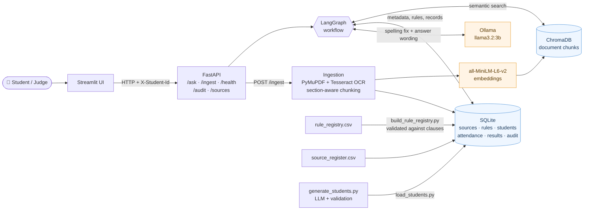
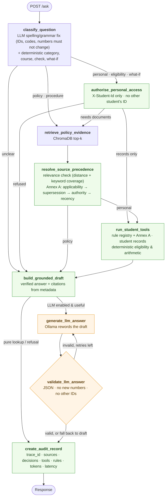

# 🎓 University Student Services Assistant

> **HCLTech Future Ready AI Engineer Hackathon** · AI-Powered University Student Services Assistant

A grounded question-answering assistant for **Dr B R Ambedkar NIT Jalandhar**. It answers policy questions
from the institute's official documents and personal questions from the student's own records, and it
never makes facts up. Every answer carries its citations, the tools that ran, the rules that were applied,
any source conflicts, and a `trace_id` that links to a full audit record.

```
"Am I eligible for the 6-month internship?"          (X-Student-Id: S1003)
        │
        ▼
 LLM fixes typos ─► classify ─► authorise ─► rule registry + Annex A precedence ─► eligibility tool
        │
        ▼
 calculated · not eligible · 4 backlogs (limit 3, clause 3.3.1, 2026-27 policy, p. 7)
 conflict: 2021 policy vs 2026-27 policy → resolved by recency
```

---

## ✨ Features

📄 **Grounded answers with citations**
- Answers only from retrieved document text; otherwise *"I could not find this information in the authorised university sources."*
- Every factual answer cites document, section/page, version and effective date
- OCR for scanned PDFs and image-only pages (charts, tables) via Tesseract

⚖️ **Versions and conflicts (Annex A)**
- Applicability by `as_of_date`, programme and batch scope (including `2023+`)
- Explicit supersession, authority level, recency; unresolved conflicts are reported, never silently chosen
- Not-yet-effective documents are mentioned as upcoming changes

🧮 **Deterministic tools**
- Attendance, results, CGPA/backlogs and eligibility computed in Python over SQLite
- Every threshold comes from the rule registry and traces back to a cited clause
- What-if questions ("If my CGPA were 9.0…") with stated assumptions

🔒 **Safety and privacy**
- Identity only from the `X-Student-Id` header; requests for another student's data are refused before any record is read
- Document text is treated as untrusted data (prompt-injection lines are stripped and logged)
- LLM output is rejected if it adds numbers or student IDs not present in the evidence

🧾 **Auditability and live ingestion**
- Audit record per answer: sources retrieved, precedence decisions, tools with inputs/outputs, rules, model, tokens, latency
- `POST /ingest` indexes a new document while the system runs; it is searchable immediately

---

## 🛠️ Tech Stack

- **API:** FastAPI + Uvicorn, Pydantic v2
- **Orchestration:** LangGraph (one fixed workflow with conditional edges)
- **Vector store:** ChromaDB, persisted to disk
- **Structured data:** SQLite (students, courses, attendance, results, rule registry, sources, audit log)
- **Embeddings:** sentence-transformers `all-MiniLM-L6-v2` (local, CPU)
- **LLM:** Ollama, `llama3.2:3b` (local; no cloud LLM, no cloud fallback)
- **Documents:** PyMuPDF + Tesseract OCR
- **UI:** Streamlit
- **Packaging:** Docker + docker compose
- **Testing:** pytest (145 tests)

---

## 📚 Document Corpus

Three official, public NIT Jalandhar documents in `data/documents/official/`, registered in
[`source_register.csv`](source_register.csv). No synthetic documents are used.

| doc_id | Document | Level | Effective | Scope | Format |
|---|---|---|---|---|---|
| `NITJ-6M-INTERNSHIP-POLICY-REV` | Institute's 6-Months Internship Policy (Revised) | 2 | 2021-09-10 | ALL | Text, 3 pages |
| `NITJ-PLACEMENT-POLICY-2026-27` | Placement & Internship Policy (2023-2027 Batch Onwards) 2026-27 | 2 | 2026-06-01 | batches 2023+ | **Scanned**, 15 pages (OCR) |
| `NITJ-PLACEMENT-BROCHURE-2023-24` | Placement Brochure 2023-24 | 4 | 2023-09-15 | ALL | Charts as images (OCR) |

**Why this corpus is interesting**
- **Real versioning.** The 2021 policy allows the 6-month internship in the 8th semester only; the 2026-27 policy allows the 7th or 8th semester for 2023+ batches. Both are level 2, so the newer one wins by recency (Annex A step 4).
- **A real internal conflict.** The 2021 policy says *"must not have more than 3 backlogs"* (Key Point 1) and *"three or more backlogs are not allowed"* (Guidelines to the Students 2). Where only that policy applies, the conflict is reported as unresolved (step 5).
- **Scanned pages and image tables** that need OCR.
- Effective dates that are not printed in a document come from the PDF metadata or the clause text, as recorded in the register's `provenance` column.

**Authority levels (Annex A):** 1 regulation/ordinance · 2 official circular · 3 department notice · 4 handbook/FAQ · 5 unofficial (informational only).

---

## 🏗️ Architecture

### System overview



### Request workflow (LangGraph)



Green steps are deterministic Python; orange steps involve the LLM, whose output is always validated.
Steps run only when needed: `START → classify → [authorise] → [retrieve → precedence] → [tools] → draft → [LLM ⇄ validate] → audit → END`.

**Retrieval vs evidence.** A chunk counts as evidence only if its cosine distance is ≤ `RETRIEVAL_MAX_DISTANCE`
(0.75) **and** at least `MIN_KEYWORD_COVERAGE` (50%) of the question's content words appear in it.
ChromaDB finds *candidates*; SQLite metadata and the rule registry decide what is *authoritative*.

**Why one fixed workflow, not agents.** Every branch (refuse early, skip retrieval, skip tools, retry the LLM)
is a deterministic routing function, so the same question always takes the same path and can be tested.
Calculations and authorisation are deterministic, so a second agent would add risk without adding capability.

---

## 📁 Project Structure

```
hackathon_project/
├── app/
│   ├── api/            # /ask, /ingest, /health, /audit/{id}, /sources, /demo/students
│   ├── graph/          # classifier, LangGraph nodes, workflow wiring, typed state
│   ├── ingestion/      # PDF/TXT/MD parsing with OCR, section-aware chunking, all-or-nothing indexing
│   ├── retrieval/      # embeddings, ChromaDB wrapper, search + keyword-coverage check
│   ├── services/       # Annex A precedence, rule registry, answer builder, audit
│   ├── tools/          # student records, eligibility, attendance arithmetic
│   ├── llm/            # Ollama client, prompts, output validation
│   ├── database/       # Annex C schema, repositories (all SQL), CSV validation
│   └── main.py
├── data/
│   ├── documents/official/   # the 3 NITJ PDFs (<doc_id>.pdf)
│   ├── rules/rule_registry.csv
│   ├── generated/            # synthetic students (Annex C CSVs + generation metadata)
│   └── evaluation/questions.json
├── scripts/            # ingest, build rules, generate/validate/load students, data card, evaluation
├── prompts/            # verbatim LLM prompts (data generation, evaluation judge)
├── reports/            # data card, evaluation report, sample audit records
├── tests/              # unit, integration, security, API (+ frozen fixtures)
├── ui/streamlit_app.py
├── source_register.csv
├── Dockerfile · docker-compose.yml · requirements.txt · .env.example
└── AI_USAGE.md · TEAM_CONTRIBUTIONS.md · DECLARATION_TEMPLATE.md
```

---

## 🚀 Quick Start

### 1. Prerequisites
- Python 3.11
- [Ollama](https://ollama.com) with the model pulled: `ollama pull llama3.2:3b`
- [Tesseract OCR](https://github.com/UB-Mannheim/tesseract/wiki) (Windows: `winget install UB-Mannheim.TesseractOCR`)

### 2. Install and configure
```bash
python -m venv .venv && .venv\Scripts\activate        # Linux/macOS: source .venv/bin/activate
pip install -r requirements.txt
cp .env.example .env                                  # set ENABLE_OCR=true and TESSDATA_DIR
```

### 3. Build the stores (first run only)
```bash
python scripts/ingest_documents.py                    # OCR + chunk + embed the 3 PDFs
python scripts/build_rule_registry.py                 # validates every rule against its clause
python scripts/load_students.py --dir data/generated/
```

### 4. Run
```bash
uvicorn app.main:app --port 8000                      # API  → http://127.0.0.1:8000/docs
streamlit run ui/streamlit_app.py                     # UI   → http://127.0.0.1:8501
```

> **Windows tip:** use `127.0.0.1` instead of `localhost` (IPv6 resolution adds ~2 s per request) and set `PYTHONUTF8=1`.

### Docker
```bash
docker compose up --build                             # API :8000, UI :8501 (OCR included in the image)
docker compose run --rm api sh -c "python scripts/ingest_documents.py && python scripts/build_rule_registry.py && python scripts/load_students.py --dir data/generated/"
```
Ollama runs on the host; compose reaches it at `http://host.docker.internal:11434`. `./data` is mounted, so
SQLite and ChromaDB persist across restarts.

---

## 🎬 Demo Script

| # | Show | Student | Question | Expected |
|---|---|---|---|---|
| 1 | Cited policy answer (OCR) | – | What is the minimum stipend for an off-campus internship in an IT company? | `retrieved_fact`: Rs 25,000/month, 2026-27 policy p. 7 |
| 2 | Tool-based eligibility | S1003 | Am I eligible for the 6-month internship? | `calculated`: not eligible, 4 backlogs vs limit 3 |
| 3 | Conflict resolved | S1001 | Am I eligible for the 6-month internship? | Eligible; conflicts tab: 2026-27 policy wins by recency |
| 4 | Version by date | S1001, as of 2026-03-01 | same | 2021 policy only: 8th semester required; backlog rules flagged as unresolved |
| 5 | Not found | – | What is the scholarship for studying in Antarctica? | `not_found` |
| 6 | Privacy | S1001 | Show me the attendance of S1002 | `refused` |
| 7 | Typo tolerance | S1002 | am i elligible for 6 month intrnship | Eligible (exactly 3 backlogs, at the limit) |
| 8 | Live ingestion | – | *Add a document* tab → upload a PDF → ask about it | Cited from the new document |

---

## 🔌 API Endpoints

| Method | Endpoint | Purpose |
|---|---|---|
| `POST` | `/ask` | Ask a question. Header `X-Student-Id` (optional); body `question`, optional `as_of_date` |
| `POST` | `/ingest` | Multipart file + Annex B metadata JSON; returns `doc_id`, `chunks_indexed`, `status` |
| `GET` | `/health` | Status of API, SQLite, ChromaDB, embedding model and LLM |
| `GET` | `/audit/{trace_id}` | Full audit record for one response |
| `GET` | `/sources` | All ingested documents and their metadata |
| `GET` | `/demo/students` | Student IDs for the UI's demo identity picker (IDs only) |

**Answer types:** `retrieved_fact` · `calculated` · `not_found` · `clarification_needed` · `refused` · `conflict_flagged`

```bash
curl http://127.0.0.1:8000/health
curl -X POST http://127.0.0.1:8000/ask -H "Content-Type: application/json" \
     -d '{"question": "When does Phase II of the placement drive start?"}'
curl -X POST http://127.0.0.1:8000/ask -H "Content-Type: application/json" -H "X-Student-Id: S1003" \
     -d '{"question": "Am I eligible for the 6-month internship?", "as_of_date": "2026-10-10"}'
curl http://127.0.0.1:8000/audit/<trace_id>
curl -X POST http://127.0.0.1:8000/ingest -F "file=@circular.pdf" \
     -F 'metadata={"doc_id":"NITJ-CIRC-2026-07","title":"Internship Circular","issuer":"Dean (Academics)","authority_level":2,"doc_type":"circular","version":"1.0","effective_from":"2026-07-01","effective_to":null,"supersedes":[],"scope_programmes":["ALL"],"scope_batches":["2023+"],"provenance":"https://www.nitj.ac.in/...","retrieved_on":"2026-10-10","synthetic":false}'
```
`/ingest` errors: unsupported type → 415, invalid metadata → 422, existing `doc_id` → 409 (send `replace=true` to replace it atomically).

---

## ⚙️ How It Works

### Source precedence (Annex A) — `app/services/precedence.py`
1. **Applicability:** `effective_from ≤ as_of_date ≤ effective_to` (inclusive) and programme/batch scope. A document with no `effective_from` is never current; future documents are reported as upcoming.
2. **Explicit supersession:** only by an applicable level 1–2 document; `DOC-ID` or clause-level `DOC-ID#Section 4.1`.
3. **Authority:** lower level number wins, regardless of date.
4. **Recency:** at the same level, the later `effective_from` wins.
5. **Unresolved:** report `conflict_flagged` and cite both. Conflicting statements inside one document are always unresolved.
6. **Level 5** content is informational only.

### Rule registry — `data/rules/rule_registry.csv`
Thresholds are never hardcoded. Each row has `parameter = <check>.<measure>`, an operator, a value and the
clause it comes from. `scripts/build_rule_registry.py` **rejects** a row whose document is not ingested, whose
section is not in that document, or whose value does not appear in the clause (digits or words such as
"three"). If any row is invalid, nothing is loaded.

| Rule | Condition | Source |
|---|---|---|
| `INT6M-SEM-2021` | `internship.current_semester == 8` | 2021 policy, Key Points |
| `INT6M-BKLG-2021-KP` | `internship.active_backlogs <= 3` | 2021 policy, Key Points |
| `INT6M-BKLG-2021-GS` | `internship.active_backlogs < 3` | 2021 policy, Guidelines to the Students |
| `INT6M-SEM-2026` | `internship.current_semester in 7,8` (batches 2023+) | 2026-27 policy, clause 3.3.1 (p. 7) |
| `INT6M-BKLG-2026` | `internship.active_backlogs <= 3` (batches 2023+) | 2026-27 policy, clause 3.3.1 (p. 7) |

Rules go through the same Annex A code as documents, so a new circular changes the applied rule on its effective date.

### The LLM's role (R5)
- **Question clean-up:** fixes spelling and grammar before analysis; rejected if it changes any student ID, course code or number.
- **Answer wording:** rephrases a verified draft from the evidence and tool results; rejected if it adds a number or student ID not in the evidence, and the verified draft is used instead.
- **Never:** eligibility decisions, arithmetic, authorisation or choosing which document prevails.

---

## 👥 Synthetic Student Data

32 fictional students (S1001–S1032) in the Annex C schema: B.Tech CSE and ECE, batches 2023 (7th semester)
and 2024 (5th semester), 8 courses. Names and CGPAs were generated by `llama3.2:3b` from the verbatim prompt in
[`prompts/synthetic_data_generation.md`](prompts/synthetic_data_generation.md) (4 schema-validated calls of 8);
IDs, attendance, results and edge cases are computed by code.

```bash
python scripts/generate_students.py --mode llm        # run after ingesting documents and building rules
python scripts/validate_students.py --dir data/generated/ --require-edge-cases
python scripts/load_students.py --dir data/generated/  # also loads judge CSVs (S9000-S9999, JDG*) unchanged
python scripts/create_data_card.py
```

| Student | Edge case |
|---|---|
| S1002 | 3 backlogs, exactly at the internship limit |
| S1003 | 4 backlogs, one above the limit |
| S1018 | 2 backlogs, one below the limit |
| S1004 | ABSENT result |
| S1005 | Failed, then passed the supplementary |
| S1006 | Failed course |
| S1009 | DETAINED, and 5th semester (not yet eligible) |
| S1010 | Multiple backlogs |

Full details, distributions and validation results: [`reports/data_card.md`](reports/data_card.md).

---

## 🧪 Testing and Evaluation

```bash
python -m pytest -q                                   # 145 passed
```
| Suite | Tests | Covers |
|---|---|---|
| `tests/unit` | 81 | chunking, OCR routing, metadata, every precedence step, `2023+` scopes, operators, LLM output and question validation, classification |
| `tests/integration` | 37 | rules by date and scope, eligibility boundaries, PDF ingest → immediate cited answer, replace/rollback, conflicts, multi-step, CSV loading |
| `tests/security` | 19 | no identity, cross-student requests, SQL-like input, prompt injection in documents, invalid rules |
| `tests/test_api.py` | 8 | API contract for every answer type, health, sources, audit |

Tests run against a frozen synthetic corpus in `tests/fixtures/`, with a temporary SQLite and ChromaDB and
`MOCK_LLM=true`, so they never touch `data/` and do not need Ollama or Tesseract.

**Evaluation:** `data/evaluation/questions.json` holds 25 questions on the NITJ corpus: policy and OCR facts,
procedures, versions/conflicts, eligibility, personal tools, cross-student and no-identity refusals,
multi-step/what-if, unanswerable and clarification. Run it (and compare retrieval configurations) with:
```bash
MOCK_LLM=true python scripts/run_evaluation.py        # writes reports/evaluation_report.md
```

---

## 🔐 Security and Privacy

- **Identity** comes only from `X-Student-Id`; a plain header is **not authentication**. Production must set it from a trusted login/gateway.
- **Authorisation** is deterministic and runs before any record is read; tools receive only the authorised ID.
- **Untrusted documents:** instruction-like sentences are removed before quoting or prompting, and recorded in the decisions.
- **SQL:** every query is parameterised.
- **Data minimisation:** names are never returned, logged or sent to the LLM; the question text of personal questions is not stored in the audit log.
- `/audit/{trace_id}` is open in this demo; production must restrict it to staff.

---

## ⚠️ Assumptions and Known Limitations

- **OCR quality.** Scanned pages and charts are noisy. Numbers read from the brochure's charts can be attributed to the wrong column by the 3B model, so check the cited page. Citations for the scanned policy are page-level ("Page 7 (OCR)").
- **Eligibility scope.** The corpus defines no course-attendance, pass-mark or placement-CGPA threshold (placement eligibility is set by each company, clause 2.1(a)). Eligibility checks therefore exist for the 6-month internship only, and the attendance/pass-mark edge cases are reported as not applicable in the data card.
- **Effective dates** not printed in a document are taken from PDF metadata or the clause text.
- **Text conflicts** between free-text passages use a heuristic (word overlap + same quantity type); rule-registry conflicts are exact.
- **Keyword check** uses 5-letter prefixes as crude stemming; unusual synonyms can cause a conservative `not_found`.
- **Local LLM.** `llama3.2:3b` sometimes merges details from several passages; validation blocks invented numbers and IDs, not invented wording.
- **Docker** is configured (including Tesseract) but the image was not built in the development environment.

---

## 📎 More

- [AI usage disclosure](AI_USAGE.md)
- [Team contributions](TEAM_CONTRIBUTIONS.md)
- [Declaration of original work](DECLARATION_TEMPLATE.md)
- [Data card](reports/data_card.md) · [Sample audit records](reports/sample_audits/) · [Source register](source_register.csv)
